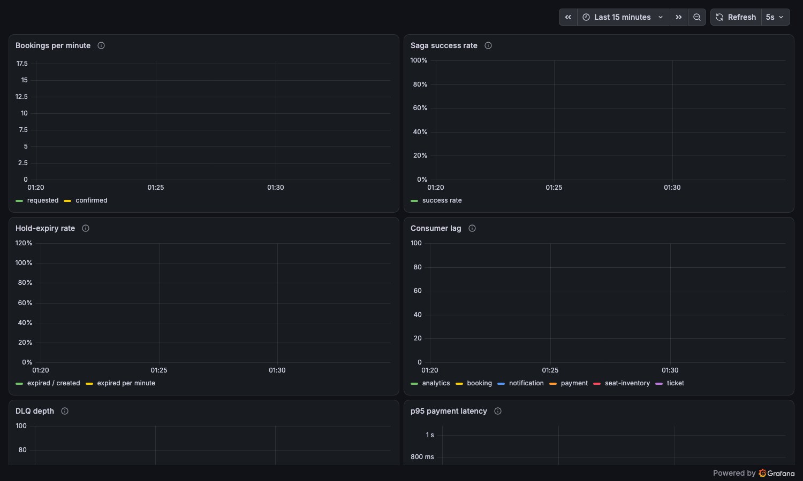

# Gatepass

Ticket booking for live events, built as an event-driven microservices system: Kafka (Redpanda), Postgres per service, Redis, NestJS services, and a Next.js frontend built from the designs in [`design/`](design/).

> **Status: Phase 6 (observability and load test), the last phase.** Every service is traced and measured, there is a Grafana dashboard, and a k6 load test proves a 1,000-seat show sells with a duplicate rate of 0.

## Architecture

```
 Browser ──REST/SSE──▶ gateway ──▶ (services, via Kafka events)

 each service:  request ─▶ [ business tables + outbox ]  one DB transaction
                                   │
                                   ▼  OutboxRelay (single active per DB)
                              Kafka / Redpanda ──▶ consumers ─▶ inbox (dedupe) + handler, one transaction
                                                       │ retries w/ backoff
                                                       ▼ exhausted
                                                  <group>.dlq
```

Built so far: **catalog**, **seat-inventory**, **booking** (saga orchestrator), **payment**, **ticket**, **notification**, **analytics** and **gateway** (with a Redis waiting room). The browser never talks to Kafka; the gateway bridges events to SSE.

### Booking and payment flow

```
POST /api/bookings ─▶ booking: booking(REQUESTED) + outbox booking.requested     (one tx)
   seat-inventory: hold ALL seats or NONE + outbox seats.held | seats.hold_failed (one tx)
   booking: seats.held ─▶ HELD (server-time holdExpiresAt, amount)   payment: seats.held ─▶ payable
   seats.hold_failed ─▶ booking CANCELLED + booking.cancelled

POST /api/bookings/:id/pay (Idempotency-Key) ─▶ payment: payment row, then provider charge
   provider webhook (signed, de-duplicated) ─▶ payment.succeeded | payment.failed
   payment.succeeded ─▶ seat-inventory: held→sold, seats.sold ─▶ booking: PAID → CONFIRMED + booking.confirmed
   payment.failed    ─▶ seat-inventory: held→available, seats.released ─▶ booking CANCELLED + booking.cancelled

booking.confirmed ─▶ ticket: one signed ticket per seat + ticket.issued ─▶ notification (email + SMS log)
every event ─▶ analytics (seat counts, tier bars, activity feed) ─▶ organizer dashboard
POST /api/checkin ─▶ ticket: verify signature, then one atomic UPDATE valid→used

abandoned hold ─▶ seat-inventory sweeper: hold.expired + seats.released ─▶ booking CANCELLED
payment lands after the sweep ─▶ seats.sale_failed ─▶ payment: automatic full refund (refund.completed, automatic)

refund: ticket valid→refund_requested + refund.requested ─▶ booking (REQUESTED) ─▶ organizer approves ─▶ refund.approved
        ─▶ payment refunds ─▶ refund.completed ─▶ ticket void + seat back on sale + dashboard + email
```

### Gateway API

| Route                              | Auth     | Notes                                                                                         |
| ---------------------------------- | -------- | --------------------------------------------------------------------------------------------- |
| `GET /api/events`                  | public   | catalog + live availability; `status`: `available`, `selling_fast`, `sold_out`, `unavailable` |
| `GET /api/events/:id/seats`        | public   | `[{id,row,number,tier,price,state}]`, state `available                                        | held | taken` |
| `GET /api/events/:id/seats/stream` | public   | SSE, `{seatId,state}` per change                                                              |
| `POST /api/bookings`               | attendee | `{eventId, seatIds}` (1 to 6 seats); user comes from the token                                |
| `GET /api/bookings/:id`            | owner    | includes `holdExpiresAt` and `serverTime` (server clock)                                      |

## Repo layout

| Path             | Purpose                                                                                      |
| ---------------- | -------------------------------------------------------------------------------------------- |
| `libs/events`    | Protobuf event catalog, generated types, envelope builder and validation                     |
| `libs/outbox`    | Outbox writer, relay, inbox guard, SQL migration                                             |
| `libs/messaging` | KafkaJS publisher and consumer, retry with backoff, DLQ                                      |
| `libs/db`        | Pool factory, SQL migration runner, env helper                                               |
| `libs/testing`   | In-process Postgres and in-memory broker for tests                                           |
| `apps/web`       | Next.js frontend, built from `design/` (pixel-identical, see ADR 0016)                       |
| `scripts/stack`  | `pnpm stack`: boots the whole system as local processes                                      |
| `services/*`     | catalog, seat-inventory, booking, payment, ticket, notification, analytics, gateway (NestJS) |
| `tests/saga`     | Cross-service saga tests                                                                     |
| `design/`        | Read-only UI source of truth                                                                 |
| `docs/adr/`      | Architecture decision records                                                                |

## Test it

```bash
pnpm install
pnpm test        # everything: unit tests plus database tests (a real Postgres runs in-process, no Docker)
pnpm lint        # eslint + prettier
pnpm typecheck
pnpm schema:lint # buf lint
```

## Run everything (one command)

You need Node 22.12+, pnpm, Java (for Kafka) and an extracted [Apache Kafka](https://kafka.apache.org/downloads) (3.9 works; it runs without ZooKeeper). No Docker.

```bash
pnpm install
KAFKA_HOME=/path/to/kafka_2.13-3.9.0 pnpm stack
```

This starts Kafka, Redis and Postgres, all eight services and the web app, publishes the five demo shows and sells out Jazz on the Roof, then prints the address (http://127.0.0.1:3100). Payments use the fake provider and complete by themselves. "Continue" on the sign-in page signs you in as a demo user: attendee, organizer (owns the demo shows) or door staff.

```bash
KAFKA_HOME=... pnpm e2e                       # boots the stack and drives a real browser through it
pnpm --filter @gatepass/web visual            # the design vs the app, pixel by pixel
pnpm --filter @gatepass/web test              # frontend unit tests
KAFKA_HOME=... pnpm chaos:real                # kill -9 services at random against the real stack
```

## Run the services by hand

There is no Docker Compose stack. Provide a Postgres server (one database and role per service) and a Kafka-compatible broker (for example Redpanda), set the variables in `.env.example`, and create the topics in `libs/events` (topic name = event type). Then, per service:

```bash
DATABASE_URL=... KAFKA_BROKERS=... pnpm --filter @gatepass/catalog start
pnpm --filter @gatepass/catalog seed     # publishes the five demo events
```

Mint a development token for the gateway (`JWT_SECRET` must match):

```bash
JWT_SECRET=... pnpm --filter @gatepass/gateway dev-token attendee user-1
JWT_SECRET=... pnpm --filter @gatepass/gateway dev-token organizer org-demo   # owns the demo events
JWT_SECRET=... pnpm --filter @gatepass/gateway dev-token door-staff staff-1
```

## Observability

```bash
KAFKA_HOME=... pnpm stack -- --observability     # also Grafana :3200, Prometheus :9090, Jaeger :16686
KAFKA_HOME=... pnpm observability:check          # proves every panel has data and traces cross services
```

Jaeger, Prometheus, Grafana and k6 are downloaded once into `~/.cache/gatepass/tools` (checksums verified); no Docker. Grafana opens on the Gatepass dashboard without a sign-in.



- **Traces.** Search Jaeger for service `gateway`, operation `POST /api/bookings`: one trace runs gateway → booking → seat-inventory → payment through Kafka. The payment is a second trace starting at `payment` `POST /webhooks/:provider` and reaching ticket and notification.
- **Metrics** (`GET /metrics` on each service; notification on 3006): `gatepass_bookings_requested_total`, `gatepass_bookings_confirmed_total`, `gatepass_bookings_cancelled_total{reason}`, `gatepass_holds_created_total`, `gatepass_holds_expired_total`, `gatepass_payments_total{outcome}`, `gatepass_payment_duration_seconds`, `gatepass_consumer_lag{group,topic}`, `gatepass_dlq_depth{dlq}`, `gatepass_outbox_pending{relay}`, `gatepass_http_request_duration_seconds`, and more. They are counted after the commit, so a redelivered message never counts twice.
- Settings: `OTEL_EXPORTER_OTLP_ENDPOINT` (tracing is off without it), `METRICS_PORT` (notification), `LAG_INTERVAL_MS`.

## Load test

```bash
KAFKA_HOME=... pnpm loadtest          # PEAK_VUS=20 for a gentler run; add -- --observability to watch it
```

k6 ramps to 50 buyers who all want seats in one 1,000-seat show. Each picks one or two seats at random, waits for the hold, pays (one time in five the payment is sent twice at once) and waits for confirmation. Afterwards the script reads the databases. Measured on one laptop (Apple silicon, one Kafka broker, embedded Postgres without fsync, fake provider answering in 100 ms), so read it as proof of correctness under contention, not as capacity:

| Measure                            | Result                                       |
| ---------------------------------- | -------------------------------------------- |
| Buyers at peak                     | 50                                           |
| Run length                         | 60 s                                         |
| Booking attempts                   | 4,602 (76.4 per second)                      |
| Bookings confirmed                 | 733 (968 of 1,000 seats sold)                |
| Refused because the seat was taken | 3,869                                        |
| HTTP requests                      | 31,719 (526 per second), 0.00% failed        |
| HTTP latency p95                   | 3 ms                                         |
| Request to seat decision p95       | 415 ms                                       |
| Pay to confirmed p95               | 417 ms (includes the fake provider's 100 ms) |
| Whole booking p95                  | 829 ms                                       |
| Double-clicked payments sent       | 159                                          |
| Seats sold twice                   | 0                                            |
| Bookings charged twice             | 0                                            |
| **Duplicate rate**                 | **0**                                        |

Duplicate rate = (seats held by two confirmed bookings + bookings with two successful charges) ÷ confirmed bookings. The run also checked 733 charges = 733 confirmed bookings and 968 tickets = 968 sold seats. See [ADR 0017](docs/adr/0017-observability-and-load.md).

## Resilience tools

```bash
pnpm replay --dlq booking.dlq --brokers localhost:9092 --dry-run     # see what would be replayed
pnpm replay --dlq booking.dlq --brokers localhost:9092               # replay dead letters once the cause is fixed
pnpm replay --dlq payment.dlq --event-id <eventId>                   # just one
```

Chaos (runs with `pnpm test`; no Docker, a real Postgres and Redis are started for you):

```bash
CHAOS_SEEDS=300 pnpm exec jest --selectProjects unit tests/chaos      # many random runs
CHAOS_SEED=42   pnpm exec jest --selectProjects unit tests/chaos      # replay one failing run exactly
```

Tuning: `HOLD_SWEEP_INTERVAL_MS` (1000), `HOLD_GRACE_MS` (60000), `WAITING_ROOM_ADMIT_PER_SECOND` (5), `WAITING_ROOM_ADMISSION_TTL_SECONDS` (300). The gateway needs `REDIS_URL`.

## Payments (test mode only)

`PAYMENT_PROVIDER=fake` (default for development) or `razorpay` (test keys `rzp_test_...` only; live keys are refused). With `fake`, tokens choose the outcome: `tok_success`, `tok_declined`, `tok_rejected`; set `FAKE_AUTO_WEBHOOK_MS` and the fake provider delivers its own signed webhook after that delay. Point the provider's webhook at `POST /webhooks/<provider>` on the payment service.

## Event envelope

Every message is an `EventEnvelope` (see `libs/events/proto/gatepass/events/v1/events.proto`): `eventId` (UUIDv7), `eventType`, `version`, `occurredAtMs`, `correlationId` (the booking ID), `causationId`, `producer`, and a typed `payload`. Topic name equals `eventType`.

CI runs `buf breaking` against the base branch on pull requests, so a breaking schema change fails the build.
